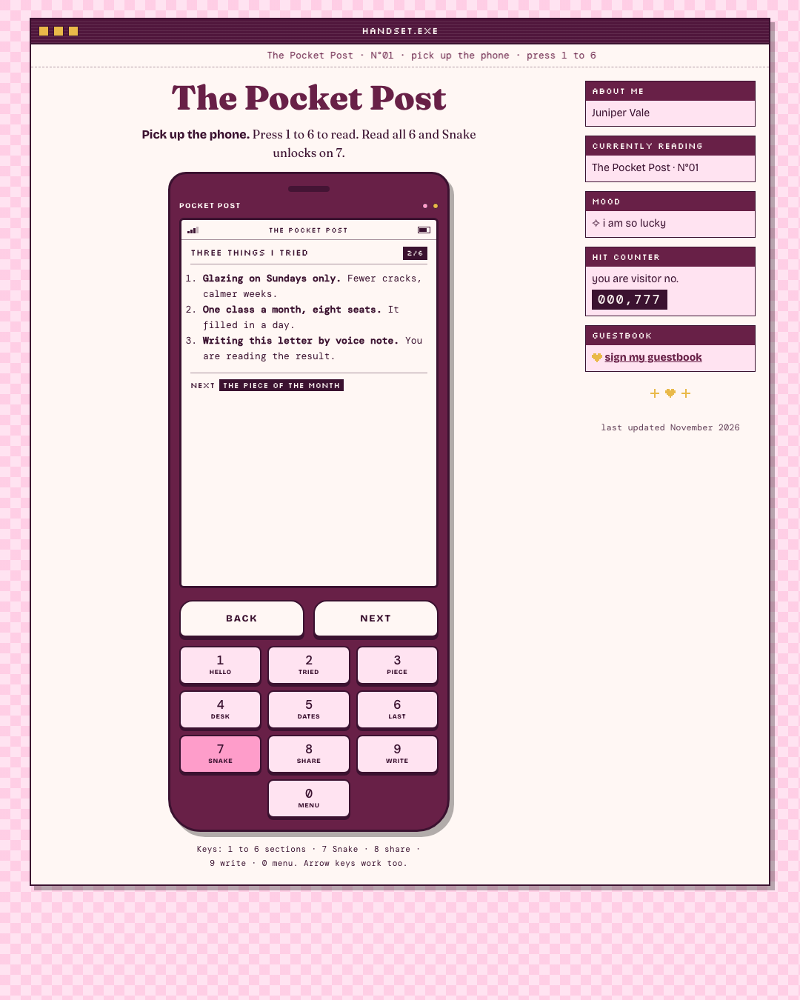
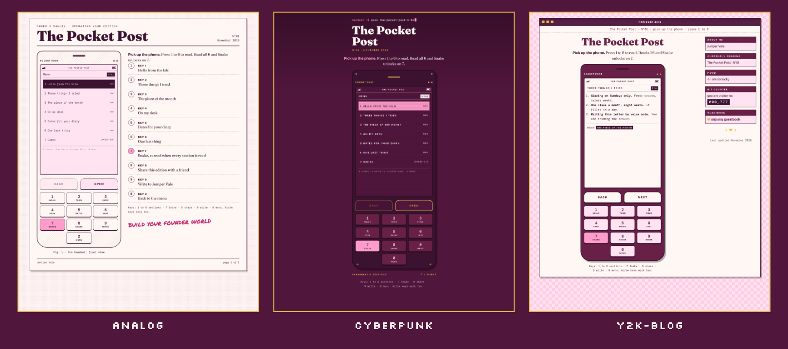

# Handset

*Rocha Coded. Free tools from the Rocheverse.*

**Any newsletter becomes a playable phone page.**

Your reader picks up the phone.
Keys 1 to 6 open your sections.
Read them all and Snake unlocks on 7.
Key 8 passes it to a friend, 9 writes to you, 0 is the menu.
One copy can carry an email gate for new readers, and its twin stays open for your subscribers.

<p align="center"></p>

<p align="center"></p>

<p align="center"><sub>One edition, three moods: analog, cyberpunk, y2k-blog. The Pocket Post, Juniper Vale and her kiln studio are made up.</sub></p>

## Start here
You can do this. Each step tells you what to type and what you will see when it worked.

**If you use Claude Code** (Claude in the terminal, the window where you type commands to your computer):

 Open the Terminal app. On a Mac it is in Applications > Utilities > Terminal.
   This checks that Python, the language the tool is written in, is ready:
   ```sh
   python3 --version
   ```
   You will see `Python 3.10` or a higher number.

 This copies the tool onto your computer. "Clone" means download a copy from GitHub, the site where the code lives:
   ```sh
   git clone https://github.com/RochaStone/handset ~/.claude/skills/handset
   ```
   You will see `Cloning into...` and then the line where you type comes back.

 This makes a folder for your editions and opens Claude Code inside it:
   ```sh
   mkdir -p ~/handset && cd ~/handset && claude
   ```
   You will see Claude Code open and wait for you.

 Type this to Claude, in your own words if you like:
   ```
   Make my newsletter a phone.
   ```
   You will see Claude ask for your newsletter's name. Then it goes through your sections one at a time.

 When Claude says your phone is built, this opens it in your browser:
   ```sh
   open out/index.html
   ```
   You will see your newsletter as a phone. Press 1.

**If you use Claude Cowork** (the Claude desktop app): download the zip (one file that holds the whole tool),
upload it in Customize > Skills, give a task your editions folder, and say "Make my newsletter a phone."
The full steps are under [Claude Cowork](#claude-cowork).

<p align="center"></p>

## What you get
- **The phone.** A splash screen, a menu, your six sections on keys 1 to 6, and soft keys BACK and NEXT that walk a reader through the whole edition in order.
- **The earned Snake.** Key 7 opens Games. Until every section is read it shows a checklist with an x beside each one done. Read them all and Snake is ready, with the arrow keys on a laptop or a swipe on a phone.
- **Share on 8.** On a phone it opens the share sheet. On a laptop it copies the link. It always shares the public page, never a reader's private link.
- **You on 9.** An email to you with the newsletter's name as the subject, or your link if you prefer.
- **Two twins.** `index.html` is open to everyone. `gated.html` asks for an email first, and sends it to the sign-up address on your own account.
- **Your look.** Analog, cyberpunk or y2k-blog, in your colours and fonts.

Each page is one file. Upload it anywhere that hosts a web page (a "static host", like your own site), and it works.
It opens on a laptop and a phone, and every look is tested at phone width with no sideways scroll.

<p align="center"></p>

## Install
It runs inside Claude. Nothing to host while you build, no account to make, and your words stay on your computer until you choose to publish them.

| Where you use it | Install it | Start it |
|---|---|---|
| [Claude Code](#claude-code) (recommended) | clone into `~/.claude/skills` | ask "make my newsletter a phone" |
| [Claude Cowork](#claude-cowork) | upload `handset.zip` as a skill | ask for the phone in a Cowork task |

You need Python 3.10 or newer. No packages to install.

### Claude Code
```sh
git clone https://github.com/RochaStone/handset ~/.claude/skills/handset
```
Open Claude Code in a folder where you want your edition saved, and ask: "Make my newsletter a phone."
To update later: `git -C ~/.claude/skills/handset pull`.

### Claude Cowork
Cowork (the Claude desktop app) runs tasks in a sandbox on your computer that can only reach the folders you give it.
1. Download `handset.zip` from the [latest release](https://github.com/RochaStone/handset/releases/latest).
2. In the Claude desktop app: Customize > Skills, then + > Create skill > Upload a skill, and pick the zip.
3. In Settings > Capabilities, turn on code execution and file creation.
4. Make a folder for your editions, for example `handset` in your home folder. Start a Cowork task, give it
   access to that folder, and ask: "Make my newsletter a phone."

<p align="center"></p>

## How to use it
Claude asks for your newsletter's name, then goes section by section: the title, the words, a short key label.
If your newsletter is already written, paste it in and Claude suggests how it splits into six.
Then it asks about the share link, how readers reach you, and whether you want the email gate.

### The email gate
The gate is a front door on one copy of the page. A reader leaves their email to pick up the phone.
- It sends `{"email": "...", "code": "..."}` as JSON to the sign-up address you give it. That address must start with `https://` and live on your own account (your email platform, your site, or a form service). It must accept requests from the website where you host the page.
- Any OK reply opens the phone. If the reply includes a `code`, the page remembers that code.
- Links with `?c=YOURCODE` on the end skip the gate. Put that link in the email to your subscribers so they never meet the door.
- The code is remembered on the reader's device, so the door opens once.

Straight talk: the gate is a polite door, not a lock. The words live inside the page, so anyone who looks at the page source can read them. It is there to welcome new readers onto your list.

## If it goes wrong (everyone's first time) 
This happens to everyone the first time. Here are the three most common moments and the fix for each.
- **The terminal says `command not found` for `python3` or `git`.** Your Mac may offer to install its developer tools. Click Install, wait for it to finish, and run the step again. If nothing pops up, install Python from python.org.
- **Claude says "Not built yet".** The line after it says exactly what is missing, like a section with no words or a gate with no sign-up address. Tell Claude "fix it with me" and it will.
- **The gate says "That did not go through".** Your sign-up address did not answer, or it does not accept requests from where the page lives. Check the address with whoever runs your email platform, or turn the gate off for now and share the open twin.

<p align="center"></p>

## Make it yours
Your look lives in one file, `style.json`: your colours, your fonts and your own scrawl line.
It ships with two examples: `examples/style.rocha-coded.json` (my plum, cream and candy pink) and a blank `style.example.json` for yours, explained in `STYLE.md`. Or ask Claude to make one with you from a few references.
Pick your motif, `analog`, `cyberpunk` or `y2k-blog`, to change the structure. Your palette and fonts re-tone all three, so every version is yours to curate.
The same file works across every Rocha Coded tool, so you make it once.

## What's inside
| File | What it does |
|---|---|
| `SKILL.md` | the steps Claude follows: the section-by-section interview, the gate, the build |
| `build.py` | checks your `edition.json`, cleans the section words, writes the public and gated pages |
| `handset_render.py` | draws the phone in all three motifs from one function, and drives Chrome for pictures and tests |
| `assets/logic.js` | the rules of the phone (what unlocks Snake, what opens the gate, where NEXT goes), with no page code in it |
| `assets/handset.js` | the phone itself: screens, keypad, share, the gate and Snake |
| `assets/*.css` | the handset, plus one file per motif |
| `examples/` | the fictional sample edition, the finished sample page, and Rocha's example style |
| `scripts/make-readme-images.py` | makes every image in this README from the tool itself, listed in `docs/IMAGES.md` |
| `tests/` | the tests, and `tests/TESTING.md` with exactly what was run |
| `style.example.json`, `STYLE.md` | your look in one file, and what each key does |

Everything is plain Python from the standard library and plain JavaScript. The page loads its fonts from Google Fonts and falls back to fonts already on the reader's device.

For the curious, run it by hand:
```sh
python3 build.py examples/edition.sample.json --out out/ --motif y2k-blog
```
To run the tests (Node runs the phone's rules, and Chrome checks every look at phone width):
```sh
node --test tests/logic.test.mjs && python3 -m unittest discover -s tests -v
```

## Licence
MIT. See [LICENSE](LICENSE). Copyright (c) 2026 Rochelle Livingstone / Thriving Era Studio.

 [Sign my guestbook](https://github.com/RochaStone/handset/issues)

## Made by Rocha

Rocha \
Brand Alchemist & AI Architect \
Author of *Brand Alchemy in the Thriving Era* \
Creator of [Conscious Founder OS](https://founders.thrivingera.com) \
Founder, [Thriving Era Studio](https://thrivingera.com)

I take female founders AI native in 7 days, and I build what they need next. \
Start with the audit: [thrivingera.com/audit](https://thrivingera.com/audit). \
Or book an exploratory call: [calendly.com/rochelle-thrivingera/exploratory-call](https://calendly.com/rochelle-thrivingera/exploratory-call). It is where we decide if we work together.

[Instagram @rocheverse](https://instagram.com/rocheverse) · [Substack](https://rochastone.substack.com) · [LinkedIn](https://www.linkedin.com/in/rochellelivingstonecosmic) · [More free tools](https://thrivingera.com/free) · [All tools on GitHub](https://github.com/RochaStone)
